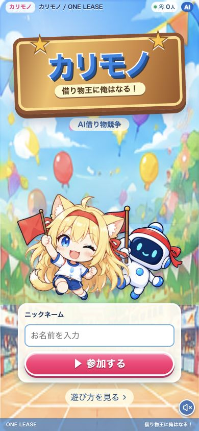
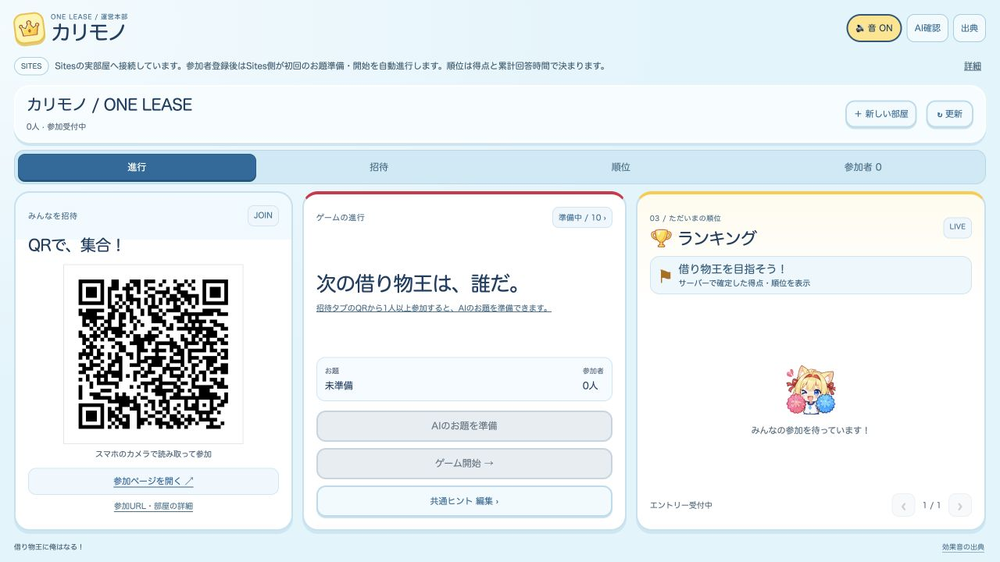
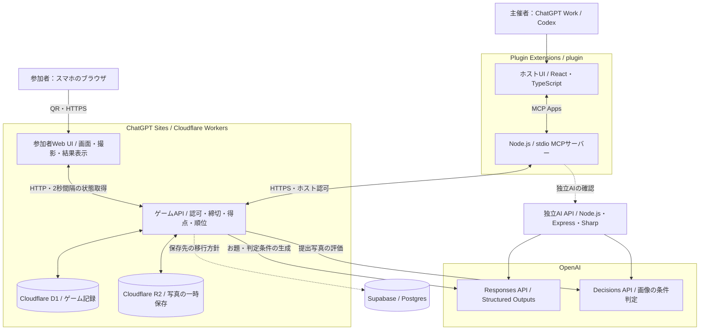

# カリモノ

**借り物王に俺はなる！** — 制作チーム **ONE LEASE**

会場にあるものを探して、スマホで撮影。AIがお題に合うかを判定し、得点と順位で競う、みんなで遊べる借り物競争です。

**公開Sites：[karimono-one-lease.ahwenu.chatgpt.site](https://karimono-one-lease.ahwenu.chatgpt.site/)**

[配備記録](docs/12-sites-deployment.md)では、v6で当時の参加者React画面とBGMを公開しています。現在のソースに追加したルート `/` の新トップ、「さっちゃん」の声、参加者画面への効果音接続は、今回まだ公開再配備していません。

参加者はホストが共有するQRまたは参加リンクから部屋に入ります。スマホへのアプリインストールやアカウント登録は不要です。ホストはChatGPT Work / Codexの **Plugin Extensions** から、招待・お題の準備・競技の進行・順位確認を行います。

## なぜ作ったか

イベントで初めて会う人同士にも、自然に話し始められるきっかけを作りたい。身近なものを探す「借り物競争」なら、会場や持ち物がそのまま遊びの材料になります。「それ、持っている？」「こんなものを見つけた！」という会話を、スマホ一つで始められるようにしました。

主催者が全員の写真を見て合否を決め、得点を集計する作業は、人数が増えるほど大変です。カリモノは、お題づくりと写真判定をAIに任せ、受付・加点・順位をサーバーで管理します。主催者も参加者と同じ会場で、ゲームの進行と盛り上げに集中できます。

### ユースケース

| 場面 | 使い方 |
| --- | --- |
| ハッカソン・勉強会の交流 | 会場にあるペンやカップなどを探すお題で、初対面の参加者が話すきっかけを作る |
| 社内イベント・新入社員の歓迎会 | 同じお題にみんなで挑戦し、部署や年次を越えて交流する |
| 友人同士の集まり・室内レクリエーション | 専用の道具を用意せず、その場にあるものとスマホで短いゲームを開催する |

## 遊び方

1. **ホストが部屋を作る。** Plugin Extensionsで参加用QRとリンクを発行します。拡張の導入は[取り込み手順](plugin/INSTALL.md)を参照してください。
2. **スマホで集合。** 参加者はQRを読み取り、ニックネームを登録します。1人目の参加から30秒後の初回開始に向けて、SitesがAIのお題を準備します。
3. **探して、撮る。** 共通のお題と判定条件を読み、会場で見つけた実物を撮影・送信します。標準のお題は1競技120秒です。
4. **AIが判定。** 合格するとその競技で500点。不合格なら、受付時間内に撮り直して挑戦できます。
5. **順位を確認して次の競技へ。** 人数とランキングは自動更新されます。2競技目以降はホストが開始し、最大10競技で借り物王を決めます。

### ゲームのルール

- 1部屋につき最大100人。各参加者がプレイヤーです。
- 各競技の最初の合格だけ500点。端末やAIが点数を決めず、サーバーが確定します。
- 順位は得点の高い順。同点なら合格写真の受付までの累計時間、参加時刻、IDの順で決まります。AIの応答が速く返った順にはしません。
- 締切はサーバーの受付時刻で判定します。同じリクエストの再送や合格後の追加提出による二重加点を防ぎます。
- 同時に進む競技は1つ。ホストが保存した共通ヒントを参加者が確認できます。10競技目の受付終了と、受付済み判定の確定後に最終結果になります。

契約と判断理由は[ADR-0013](docs/adr/0013-issue1-player-game-contract.md)、入出力は[API受け渡し資料](docs/14-issue1-ahwenu-handoff.md)を参照してください。

## 画面

2026年10月18日に取得した画面です。スマホ向けはv6配備時点の参加者画面を反映した公開Sitesの実部屋を、390×844のブラウザ表示領域で撮り直した記録です。ホスト向けはPlugin Extensions用UIをSitesへ実接続したブラウザプレビューです。撮影条件は[画像の記録](docs/images/README.md)にまとめています。

### スマホからの参加



### Plugin Extensions用のホスト画面

招待QR、競技の進行、ランキングを同じ画面で確認できます。狭いパネルではタブ、多人数の一覧ではページを切り替えます。



## 技術スタックとサービス構成

参加者の画面とゲームAPIは **ChatGPT Sites**、ホスト画面は **Plugin Extensions** に配置します。MCPサーバーがホストの操作をSitesのHTTP APIへ橋渡しし、ゲーム状態の正本をSites側に集約します。



| 領域 | 技術・サービス | 役割・実装場所 |
| --- | --- | --- |
| Web公開・サーバー | ChatGPT Sites / Cloudflare Workers / Vinext・Vite | 参加者画面・静的資産と同一オリジンの `/api/rooms/:id` を配信。`apps/cloud/` |
| 新トップ・参加者画面 | React / TypeScript / CSS | ソース上は `/` が新トップ、`/rooms/:id/join` が参加・撮影・結果・順位。`apps/cloud/app/participant/` |
| 旧ブラウザホスト画面 | HTML / CSS / JavaScript | ソース上は `/host` が旧部屋作成、`/rooms/:id/host` が部屋ホスト。`apps/web/` からSites向け資産を生成 |
| ホスト画面 | Plugin Extensions / React / TypeScript | QR招待、進行、共通ヒント、参加者・順位表示、ランキング変化の演出。`plugin/src/ui/` |
| 拡張とゲームの接続 | MCP / MCP Apps SDK / Node.js / Zod | UI操作をツール呼び出しに変換し、Sites応答を検証して表示。`plugin/src/server/` |
| お題生成 | OpenAI Responses API / Structured Outputs | お題・説明・2つの判定条件・制限時間をJSON Schemaに沿って生成。`apps/cloud/lib/text-agent.mjs` |
| 写真判定 | OpenAI Decisions API | 実物の写真か、お題の各条件を満たすかを個別に評価。全条件の確率が0.8以上なら合格。`apps/cloud/lib/cloud-ai.ts` |
| ゲーム記録 | Cloudflare D1 / Drizzle ORM | 部屋、参加者、競技、提出、判定状態を永続化し、確定得点を集計。`apps/cloud/lib/`・`apps/cloud/db/`・`apps/cloud/drizzle/` |
| 写真の保存 | Cloudflare R2 | 判定中だけ写真を非公開で保存し、判定後に削除 |
| 独立AI API | Node.js / Express / OpenAI SDK / Sharp | お題生成・写真判定を独立したHTTPサービスとして提供。ゲーム進行・得点・DBを持たない。`api/` |
| 画面同期 | fetch / 2秒ポーリング | サーバーのスナップショットから参加人数・競技・得点・順位を更新 |
| 音・演出 | 同梱MP3 / CSSアニメーション | 参加・撮影・開始・合否・順位変化を音や動きで通知。音のON/OFFに対応 |

図の実線は実装の接続経路です。**Supabase / Postgresへの保存移行は採用方針**で、接続・スキーマ・移行の実装と検証は別途必要です。D1/R2の実装・検証結果をSupabaseの動作実績には含めません（[ADR-0016](docs/adr/0016-supabase-game-persistence.md)、[統合契約](docs/16-supabase-integration.md)）。独立AI APIの確認経路も、Sitesが直接OpenAIを呼ぶゲームの経路と分かれています。

参考写真付きのお題を作るAgents API経路もソースにあります。これは `AI_REFERENCE_PHOTOS=true` で明示的に有効にする追加モードで、標準のお題生成には使いません。成功の検証は未完了です（[AI連携仕様](docs/11-api-integration.md)）。

### 処理の工夫

**AIの役割を分ける。** Responses APIはお題と条件を作り、Decisions APIは写真をその条件ごとに評価します。生成された文章をそのまま信用せず構造を検証し、AIの拒否や通信失敗を自動合格にしません。得点と順位はゲームAPIが確定します。

**通信や判定速度で不公平を増やさない。** 写真受付をHTTP 202で返し、D1のキューで判定を処理します。同時判定数を制御し、リクエストIDとDBの制約で重複受付・二重加点を防ぎます。順位の時間比較にはAIの処理完了時刻ではなく写真の受付時刻を使います。

**スマホとホストに秘密を渡さない。** OpenAIキーはサーバーだけが扱います。ホストの部屋権限はMCPサーバーで保持し、参加者は部屋限定の認証を使います。参加者の画面に他人の提出写真やトークンを渡さず、写真は判定後に削除します。

## 審査基準への対応

[DevDay Community Hackathonの審査基準](https://luma.com/OpenAIDevDay2026CommunityHackathonTokyo)である4つの観点に、次の実装と体験で応えます。

| 審査観点 | カリモノでの対応 |
| --- | --- |
| **新機能の活用** | **Sites**でQRから入れるWebゲームを公開し、**Plugin Extensions / MCP Apps**を主催者の運営画面に使用。**Decisions API**は「実物か」「各条件を満たすか」という写真判定に使います。Responses APIの構造化出力と組み合わせ、お題づくりから判定・順位反映までをゲームの操作につなげています。 |
| **使いやすさ** | 参加者はQRとニックネームだけで参加でき、インストールやアカウント作成が不要です。撮影・送信・結果確認をスマホで行い、人数と順位は自動更新。ホストは招待・進行・順位を一画面で扱え、狭い表示でもタブとページ切り替えで操作できます。 |
| **有用性** | 主催者によるお題の用意、写真の合否確認、得点集計をシステムが担います。会場の身近なものを使うため専用の小道具を用意せず開催でき、ハッカソン・社内交流・歓迎会などのアイスブレイクに使えます。 |
| **独創性** | 昔ながらの借り物競争に、会場や参加者情報を踏まえたAIのお題、写真の条件判定、変化が見えるランキングを組み合わせました。参加者は現実の会場で探し、主催者はPlugin Extensionsで運営する役割分担が、画面の外での交流を支えます。 |

## 検証記録

実装の確認と、公開環境・実AI・実端末の確認を分けて記録しています。

- **公開API：** 100HTTPクライアントの参加、100写真の受付、各500点、本人の結果分離、共通ヒントの取得を確認。加点の負荷確認には固定の判定応答を使用しました。終盤の通信失敗と後続確認の結果も[受け渡し記録](docs/14-issue1-ahwenu-handoff.md)に残しています。
- **実AI：** 公開SitesとMCPを通じたResponses APIのお題生成、JPEG提出、Decisions APIによる条件不一致・0点の経路を確認。実AIでの合格500点、判定品質の評価、100実端末の同時利用は未検証です。
- **ホストUI：** 接続の再試行、複数サイズの表示、多人数の一覧、ランキング変化の検証記録は[Plugin Extensions仕様](docs/08-plugin-extensions.md)にまとめています。
- **READMEの画面画像：** 公開Sitesの参加画面と、Sitesへ実接続したホストUIをブラウザで取得しました。実機カメラ撮影やネイティブ拡張パネルの直接操作を検証した記録ではありません。

## 開発する

Node.js **22.13.0以上**とnpmを使います。Sites、Plugin Extensions、独立AI APIは別々のビルド単位です。

### 参加者画面・Sites

```sh
npm --prefix apps/cloud run install:ci
npm --prefix apps/cloud run dev
```

`http://localhost:5173/` が新しいReactトップです。ゲームスタートから参加リンク・部屋IDを入力します。`http://localhost:5173/design-preview` では8種類の画面状態を比較できます。旧HTMLの部屋作成はビルド版の `/host` に残しています。実ゲームのローカルDB設定、型検査、ビルド、HTTPSでのスマホ確認は[参加者フロントエンドの手順](docs/participant-frontend/README.md)を参照してください。リポジトリ直下の `npm run dev` は `apps/server/` を起動するため、Sites開発では上記のコマンドを使います。

### ホスト拡張

```sh
npm --prefix plugin ci
npm --prefix plugin run check
npm --prefix plugin test
npm --prefix plugin run build
```

導入は[INSTALL.md](plugin/INSTALL.md)、開発・共有パッケージの作成は[plugin/README.md](plugin/README.md)を参照してください。公開Sitesへの接続設定は以下です。

```dotenv
KARIMONO_MODE=sites
SITES_API_BASE_URL=https://karimono-one-lease.ahwenu.chatgpt.site
```

設定はGit対象外の `plugin/.env.local` へ置きます。独立AI APIも使う環境では、既存の `KARIMONO_API_URL`・`KARIMONO_API_TOKEN_FILE` の参照を引き継ぎます。キーやトークンの値はコード・画像・共有ファイルへ含めません。独立APIの起動は[api/README.md](api/README.md)を参照してください。

### フォルダ構成

```text
README.md              プロジェクトの概要・遊び方・技術・審査観点
Project.md             仕様と開発文書の入口
apps/cloud/            新Reactトップ /・参加者画面・Workers API・DB定義
apps/web/              旧HTMLの /host・部屋ホスト用の配信資産
apps/server/           ローカル実行用サーバー
plugin/                Plugin ExtensionsのホストUI・MCPサーバー
api/                   独立したお題生成・写真判定API
docs/                  仕様・担当間の契約・検証記録
docs/adr/              技術やゲームルールの判断履歴
docs/images/           READMEに掲載する画面画像と取得記録
```

## 制作チーム

| 領域 | 担当 |
| --- | --- |
| デザイン | Akibako さん |
| モバイルフロントエンド | mae さん |
| バックエンド・ゲーム処理・保存 | さが さん |
| HTTP API・AI接続・MCP | Ahwenu |
| Plugin Extensionsの画面開発 | 未定（Ahwenuが暫定候補） |

制作チーム名は **ONE LEASE** です。ゲーム内では各参加者がニックネームで参加します。担当と受け渡しの詳細は[開発手順](docs/07-delivery-plan.md)を参照してください。

## 詳しい資料・クレジット

- [Project.md](Project.md)：仕様・技術構成・担当分担の入口
- [ADR一覧](docs/adr/README.md)：画面配置、ゲーム契約、保存先などの決定と理由
- [参加者画面の作業コンテキスト](docs/participant-frontend/mobile-frontend-context.md)：画面とAPIの対応
- [ホスト画面仕様](docs/08-plugin-extensions.md)：Plugin Extensions・接続・表示の検証
- [素材ガイド](docs/design/sports-day-ui-assets-v1/README.md)：運動会テーマとキャラクター素材
- 効果音・ジングル：[OtoLogic](https://otologic.jp/) / [CC BY 4.0](https://creativecommons.org/licenses/by/4.0/)。長さ・音量・フェードなどを調整して同梱しています。[音源と加工内容](docs/15-sound-effects.md)
