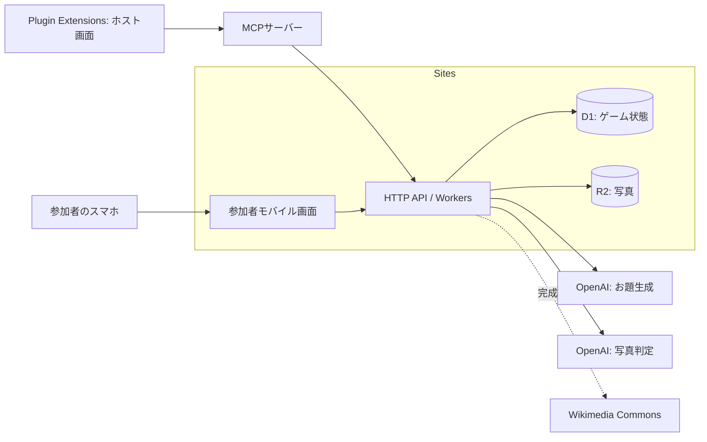

# 技術構成と採用方針

## 方針

追加指示を優先し、Sitesには参加者向けモバイル画面・API・DB・画像保存を集約する。ホスト画面はPlugin Extensionsに分離し、MCP経由で同じSitesバックエンドを操作する。同一リポジトリで、Akibako さん（デザイン）、mae さん（モバイルフロントエンド）、さが さん（バックエンド）、Ahwenu（API処理）が責務を分ける。拡張画面開発は未定（Ahwenu）。詳細は[07 分担](07-delivery-plan.md)と[08 Plugin Extensions](08-plugin-extensions.md)を参照。

Sitesスキルの提供仕様では、サーバーはCloudflare Workers、構造化データはD1、ファイルはR2を使う。これは利用可能な構成の確認であり、このリポジトリでのプロビジョニングや動作確認は未実施。作業時点の同梱Sitesスキルの `SKILL.md`、`references/storage.md`、`references/identity-and-secrets.md` に基づく。

| 領域 | 推奨技術 | 選定理由・条件 |
| --- | --- | --- |
| フロントエンド | SitesのVinextスターター、React、TypeScript | サーバー処理が必要なため公式スターターに合わせる |
| ホスト画面 | Plugin Extensions、React/TypeScript、MCP App UI | 参加者一覧・順位・進行操作を拡張内に実装 |
| ホスト接続 | MCPサーバー、MCP Apps SDK | UIの操作をSites HTTP APIに橋渡し。MVPはCodexローカルstdio方式を検証 |
| UI | CSS変数と共通コンポーネント | 色・文字・余白を統一。CSSライブラリ追加は担当間で判断 |
| サーバー/API | スターターのHTTPルート、TypeScript、Workers | 同一オリジンの `/api/v1` に集約 |
| DB | D1、スターターのDrizzleスキーマ・マイグレーション | 部屋・チーム・提出・加点を永続化 |
| 画像 | 非公開のR2、認可付き配信ルート | 写真の公開URLを恒久配布しない |
| データ検証 | Zod等の共有スキーマ | API境界とAI生成物を検証。導入時に互換性確認 |
| 端末撮影 | WebカメラAPI、Canvasで縮小 | JPEGへの統一、EXIF除去、送信量削減 |
| 画面同期 | fetchによる2秒ポーリング | MVPで常時接続や追加のリアルタイム基盤を増やさない |
| AI接続 | サーバーのfetch、必要ならOpenAI SDK | お題生成と画像判定をアダプターで分離 |
| 検証 | 状態処理・APIの自動テスト＋実機テスト | 二重加点と締切を優先して検証 |

バージョンは実装開始時のスターターと互換性を確認し、ロックファイルで固定する。本書では未検証の最新版番号を指定しない。

## 依存関係と境界

- UIはAPIレスポンスから描画する。得点・締切・ラウンド状態の最終決定はサーバーが行う。
- UIコンポーネントはAPIを直接呼ばない。フロントエンド担当がデータ取得と操作を渡す。
- ゲーム処理はOpenAIレスポンス形式に依存せず、06の内部インターフェースを使う。
- メモリ内変数やlocalStorageをゲーム記録の正本にしない。端末には音設定などの補助情報だけを保存する。
- WorkersはNode常駐サーバーと異なる。raw TCP前提のDB接続、ローカルディスク保存、無制限のバックグラウンド実行に依存しない。HTTP外部接続と128 MBのメモリ制約を前提に画像を制限する。
- MVPの判定は提出HTTPリクエスト内で実行し、DBに開始状態を保存する。切断やプロセス終了時は期限で失敗確定できる設計にする。完了保証付き非同期処理は完成版で基盤対応を確認して導入する。

## Sitesで最初に確認すること

1. スターターの起動・ビルド、API、D1/R2バインディングを小さいサンプルで確認する。
2. 公開サイトでゲストが参加でき、Plugin Extensions→MCP→Sitesの接続・ホスト認可が機能することを確認する。Sitesのブラウザ認証をMCP接続の認証として流用できるとは仮定しない。非公開サイトでは参加者にもログインが必要になる点を確認する。
3. 実機HTTPSでカメラ、画像送信、OpenAI外部通信、秘密情報の設定を確認する。
4. リクエストの実行時間・画像上限・費用上限を測定し、判定を含む15秒のアプリ側予算が適切か確定する。
5. D1の原子的な更新と一意制約で、同時提出・重複処理が安全になることを確認する。

未対応の機能が判明した場合は、同じAPI契約を保った外部HTTPバックエンドへの切り出しを代替案にする。Sites上で未確認のキュー・スケジューラー・WebSocketを必須条件にしない。

## ディレクトリと配備単位

詳細な配置の正本は[09 フォルダ構成・デプロイ](09-repository-structure.md)とする。Sitesはリポジトリ直下、Plugin Extensionsはplugin/に置く案。依存・lock・ビルド出力を分け、Sitesを配備するためにpluginのビルドを要求しない。

デザインはcomponents/styles、モバイル処理はfeatures/lib/mobile、バックエンドはserver/game・auth・storage・repositoriesとdb、API処理はapp/api・server/http・integrations、拡張画面はplugin/src/uiへ分ける。共有DTOはcontractsに置く。

配置は導入するスターターに合わせて調整する。Sitesのビルド統合とホスティング設定を維持し、別のフレームワークに独自置換しない。構成案は[ADR-0006](adr/0006-deployment-and-folder-boundaries.md)の検証後に採否を確定する。

## 秘密情報・環境

開発・検証・本番でDBと画像を分離する。設定候補は `OPENAI_API_KEY`、`TOPIC_PROVIDER`、`JUDGE_PROVIDER`、`TOPIC_MODEL`、`JUDGE_MODEL`、`SESSION_SECRET`。ホスト接続用には `SITES_API_BASE_URL` と、08で定義する `HOST_SERVICE_TOKEN` を使う。値はサーバー専用とし、`.env.example`にはキー名だけを置く。`DB` / `BUCKET`はSitesのバインディングを利用する。

本書作成ではAPIキー取得・有料API呼び出し・公開は行わない。実装時のキー設定は提供される公式フローで行う。
