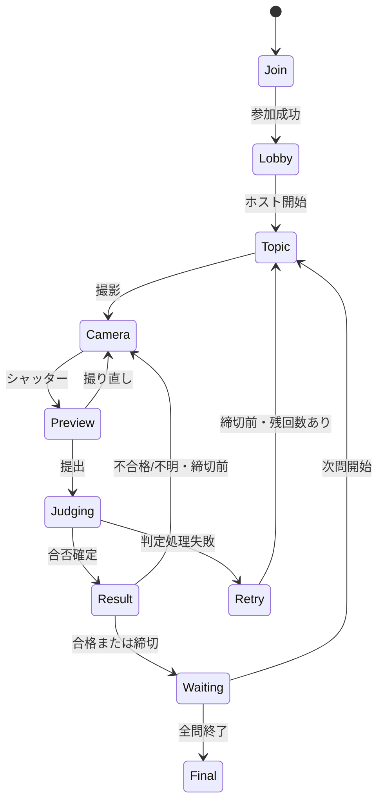

# 画面仕様・デザインとフロントエンドの境界

## Issue #1対応の現在の受け渡し

100人全員が個人プレイヤーとして参加し、最大10競技・各競技の初合格500点をサーバーが確定する。`game`、全10件の`stages`、`ranks[].score/rank`、`mine[].awardedPoints`、共通ヒントのGETは[12の応答例](12-issue1-backend-handoff.md)と[ADR-0013](adr/0013-issue1-player-game-contract.md)を基準とする。点数やステージ解放を端末で仮計算しない。開始前はround=null、競技間は直前roundのclosedを表示し、ホストが次競技を開始するまで待機する。ヒント未用意はavailable=false、写真の処理状態はqueued/processing/accepted/rejected/error。順位は連番で、同点同順位の初期案は使わない。

今回の変更はバックエンドのみで、下記の画面構成・React部品・Cookie契約などの初期案をUIへ実装したものではない。既存参加者はBearerで接続し、写真は1MiB以下。新しい画面への組み込みとスマホ実機確認はmae・Akibako担当への後続受け渡し。公開先には未配備。

デザインはAkibako さん、Sitesの参加者向けフロントエンド開発はmae さん。Plugin Extensionsのホスト画面開発は未定（Ahwenu）とし、mae さんの担当には含めない。API処理はAhwenu、バックエンドはさが さんが担当する。

## デザイン方針

参加入口にアプリ名「カリモノ」とキャッチコピー「借り物王に俺はなる！」を表示する。チーム名「ONE LEASE」はアプリの制作チーム表記であり、ゲーム内の参加チーム名とは区別する。ホスト拡張の表示名も「カリモノ」に揃える。開発者名義の著作権表記とは別の情報として扱う。

片手のスマホ操作を優先する。お題・残り時間・撮影ボタンを最も強く見せる。添付ポスターの青・オレンジ・楽しさを参考にするが、ポスター全体を画面に縮小しない。

- 360〜430px幅の縦画面を中心に設計し、320px幅でも横スクロールを出さない。
- 通常文字は16px以上、主要なタップ領域は44px以上を初期基準にする。
- お題、締切、判定結果は色だけに依存せず、文章とアイコンを添える。
- ボタンは下部に置き、端末のセーフエリアとソフトキーボードを考慮する。
- 音なしでも完結させる。動きを減らす設定とスクリーンリーダーを考慮する。
- 画像やニックネームはサーバー提供内容も含めて安全に描画する。

## MVP画面一覧

| ID / URL案 | 主な表示 | 操作 | 必要な状態 |
| --- | --- | --- | --- |
| P01 `/` | 参加コード、チーム名、ルール | 参加 | 入力、検証中、満員、開始済み、無効コード |
| P02 `/play/:roomId` ロビー | コード、チーム一覧、自チーム | 開始待ち | 読込、待機、通信切断 |
| P03 同URL お題 | 問題番号、文章、120秒、自得点 | カメラを開く | active、提出中、合格済み、締切 |
| P04 同URL 撮影 | プレビュー、短い撮影ガイド | 撮影、閉じる | 許可待ち、起動中、拒否、利用不可 |
| P05 同URL 確認 | 撮った写真、お題 | 送信、撮り直し | 送信可能、送信中、サイズ超過、変換失敗 |
| P06 同URL 判定 | 写真、判定中の表示 | 状態確認、失敗時の再試行 | queued、judging、判定失敗 |
| P07 同URL 結果 | 合否、理由、加点、順位 | 不合格時の再撮影、順位表示 | pass、fail、uncertain、締切、次問待ち |
| P08 同URL 最終結果 | 最終順位、総得点、同順位 | 結果の確認 | finished |

ホスト画面H01〜H03はSitesのURLに作らず、[08 Plugin Extensions](08-plugin-extensions.md)に定義する。`HostControls`等の共通表示部品は共有可能だが、ホストのデータ取得はMCPアダプターで実装する。

URLを画面ごとに増やすことは必須ではない。部屋のサーバー状態に従って同じURL内の表示を切り替える。未来のお題は参加者に渡さない。

## デザイン担当 → フロントエンド担当

Akibako さんは以下の共通表示部品と参加者画面の状態見本を作り、mae さんへ渡す。モバイルのAPI接続、カメラストリーム、残り時間表示はmae さんが持つ。ホスト用部品は共通仕様を参照し、拡張画面担当が組み込む。締切の最終判定はさが さんのバックエンドで行う。

| コンポーネント | 主なprops | イベント |
| --- | --- | --- |
| `JoinForm` | busy、error | onJoin(code, teamName) |
| `LobbyView` | roomCode、teams、myTeamId | なし |
| `TopicCard` | title、instruction、roundNumber | なし |
| `Countdown` | remainingSeconds、isClosing | なし |
| `CameraView` | preview要素、permissionState | onCapture、onClose |
| `PhotoPreview` | objectUrl、isSubmitting、error | onSubmit、onRetake |
| `JudgmentView` | status、outcome、reasonCode、awardedPoints | onRetry、onShowRanking |
| `Leaderboard` | entries、myTeamId、isFinal | なし |
| `HostControls` | canStart、canAdvance、canFinish、busy | onStart、onAdvance、onFinish |

`outcome`は `pass | fail | uncertain | null`。処理失敗は合否と分離する。デザインでローカルな成功表示を先に出さず、`awardedPoints`はAPI確定値を表示する。

受け渡し成果物：共通の色・余白・文字トークン、各画面の読込/空/エラー/完了状態、押下中・無効のボタン、上記propsに対応するモック表示。デザインツールでの案だけでなく、可能なら実装コンポーネントとして渡す。

## フロントエンド処理担当の責務

- 共有DTOとAPIクライアント、部屋取得、操作中状態、エラー文言への変換を管理する。
- APIの `serverTime` と端末時刻の差を使って残り時間を描画する。表示が0になったら提出を止めるが、最終認可はサーバーに任せる。
- 表示中は2秒ごとに部屋・必要な提出を取得する。タブ復帰時は即時取得し、通信エラー時は2→4→8秒に間隔を広げる。
- `room.version` が古いレスポンスで最新画面を上書きしない。終了したラウンドの結果は現在のお題と混ぜない。
- 再読込後は参加セッションと部屋状態から復帰する。カメラの再開にはユーザー操作を必要とする。
- 送信ごとにIdempotency-Keyを生成し、通信失敗で同じ写真を再送するときは同じキーを使う。別の撮影・再挑戦には新しいキーを使う。
- 判定中に接続が切れても、新しい提出を勝手に作らず、取得APIで既存の処理状態を確認する。

## カメラと画像の取り扱い

HTTPSとユーザーの許可がカメラ利用の前提となる。[MDN: getUserMedia](https://developer.mozilla.org/en-US/docs/Web/API/MediaDevices/getUserMedia)

MVPはユーザー操作で `getUserMedia` を開始し、背面カメラを優先する。撮影後はCanvasで長辺1280px以下のJPEGにし、2 MiB以下で送る。変換後も大きければ再圧縮し、上限を満たせなければ送信しない。離脱時にカメラトラックを止め、プレビューURLを解放する。

カメラが使えない端末向けに `input type=file` と `accept=image/*`、`capture=environment` を代替候補とし、実機で動作を確認する。ファイル選択を許す場合は過去写真を排除できないため、MVPでは厳密な不正防止を保証しない。サーバーが扱う形式はJPEGに限定し、HEIC等を変換できない場合は説明して撮り直しへ誘導する。

## 2026-10-18 効果音の追加

ユーザー指示により、操作・参加・開始・正解/不正解・残り5秒・結果発表の音を追加。モバイルは撮影・写真受付、Pluginはサーバーの加点増分と共通ヒント保存にも反応します。ON/OFF、作者/ライセンス表示、初回・定期同期の重複抑制を含みます。出典と検証範囲は[効果音仕様](15-sound-effects.md)を参照。ゲームルールと確定得点の契約は維持します。
