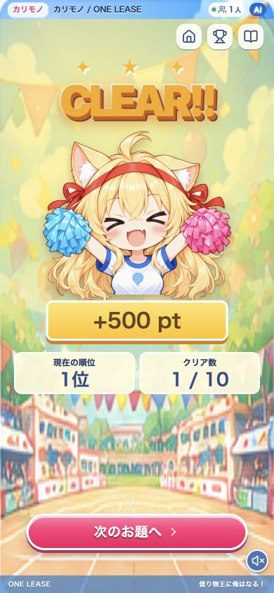
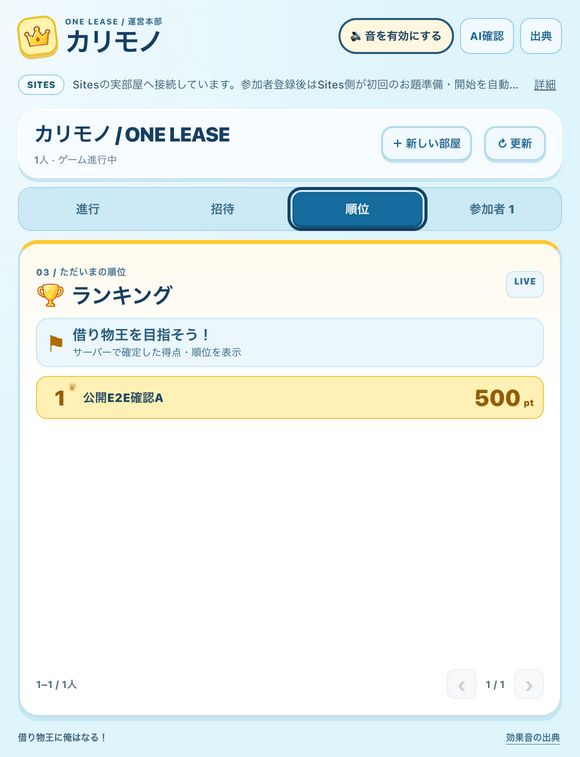

# 公開ゲームの一連確認（2026-10-18）

対象：`https://karimono-one-lease.ahwenu.chatgpt.site/`。ホストはインストール済みPlugin Extensions 0.4.1の実パネル、参加者は390×844のブラウザ表示を使用した。スマホ実機のカメラ撮影とは区別する。

## 確認した流れ

1. 実拡張の「新しい部屋を作る」で確認用部屋 `2b5254d15b084801b015f0bda31fbe08` を作成し、招待QRと `/rooms/:id/join` の参加URLを表示。
2. そのURLを開き、参加者「公開E2E確認A」を画面から登録。参加者画面と実拡張の両方で1人を確認。
3. ゲーム用AIの準備完了後、実拡張から開始。Responses APIのお題「カラフルな紙コップを探そう」を公開状態APIと画面で確認。
4. 写真選択から実物の赤い紙コップ写真を選び、プレビュー後に「写真を送る」を実行。写真はブラウザの通常のJPEG変換を通し、条件に合わせる色変更や画像生成は行っていない。
5. 「AIが判定中」から「CLEAR!!・+500pt・1位・1/10」へ進み、実拡張にも同じ参加者の500ptが自動反映。
6. 参加者のランキングで500pt・1位、実拡張の順位タブで500pt・1位が一致。参加ページ再読み込み後もクリア画面と500点が復帰した。

部屋はAIモードで、お題の `provider` は `Responses API`。写真判定は公開サーバーのDecisions API経路で実行され、固定の合格応答へ切り替えていない。判定基準は「対象は飲み物を入れる紙コップである」「紙コップの側面に色や模様が見える」。実AIの合格加点と両画面への順位反映を今回の一連操作で確認した。

## 発見した不具合と修正

React参加者画面はお題のタイトル・説明だけを表示し、AIが必須判定に使う `challenge.criteria` を表示していなかった。上記の2条件は公開APIにはあるが、写真提出画面には出ていないことを確認した。

`ParticipantGame.tsx` と `participant.css` で、サーバーの判定基準全件と「条件に合う実物を撮影してください。画面や印刷された写真は使えません。」をお題カード内へ追加する。採点・API・DBは変更しない。最新mainの事前招待用の待機表示を保持して取り込んだ。

修正はJSX構文検査、React静的描画（基準・注意文・欠落データ・HTMLエスケープ）、TypeScript noEmit、Cloud9テスト、差分チェックを通過。公開への反映と表示確認の結果は、この文書へ追記する。

## 写真の出典と範囲

- 写真：[Hands holding a cup of coffee, Quebec City](https://commons.wikimedia.org/wiki/File:Hands_holding_a_cup_of_coffee,_Quebec_City.jpg)
- 撮影者：Wilfredor、ライセンス：[CC0](https://creativecommons.org/publicdomain/zero/1.0/)。既存の `plugin/artifacts/red-paper-cup.jpg` を使用。
- 公開済みの実物写真を写真選択で提出した確認であり、会場で撮影したこと、実機カメラ、判定精度全般、100実端末の性能を検証したものではない。
- 参加者の認証情報、ホストCookie、OpenAIキーは画像・本文・Gitへ含めていない。
